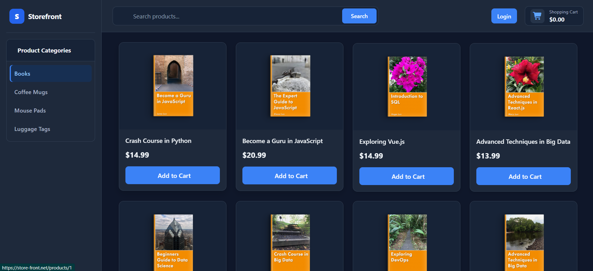
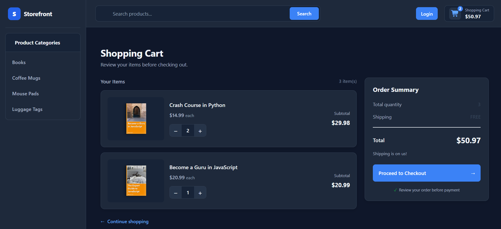
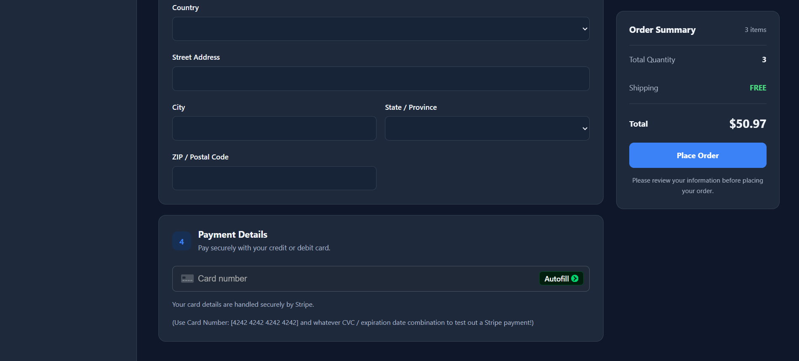
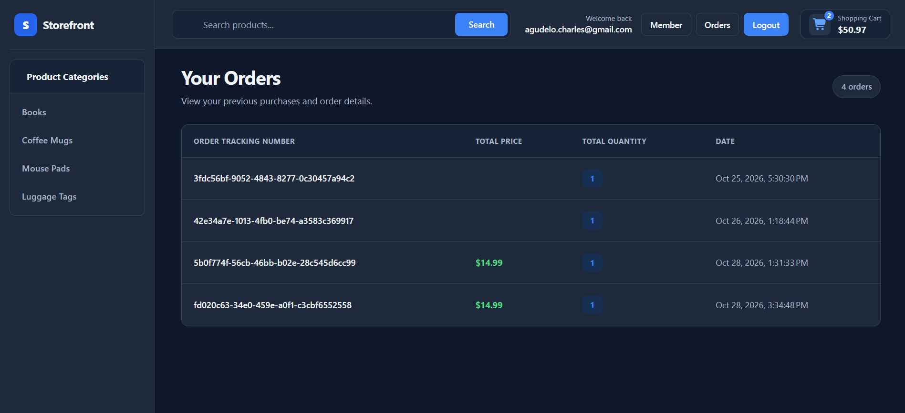

# [Store-Front](https://store-front.net)

A fullstack ecommerce website with the front end written in Angular using TypeScript and the back end using Spring Boot written in Java, all hosted on AWS

Implements pagination, search, product view, category view, and checkout using Spring Data JPA, Spring Data Rest, and Spring Web

Dynamic cart functionality built using Angular standalone components with Dependency Injections for state management

Payment processing powered using Stripe! Test it out using card number 4242 4242 4242 4242

Login and authentication handled using Auth0
